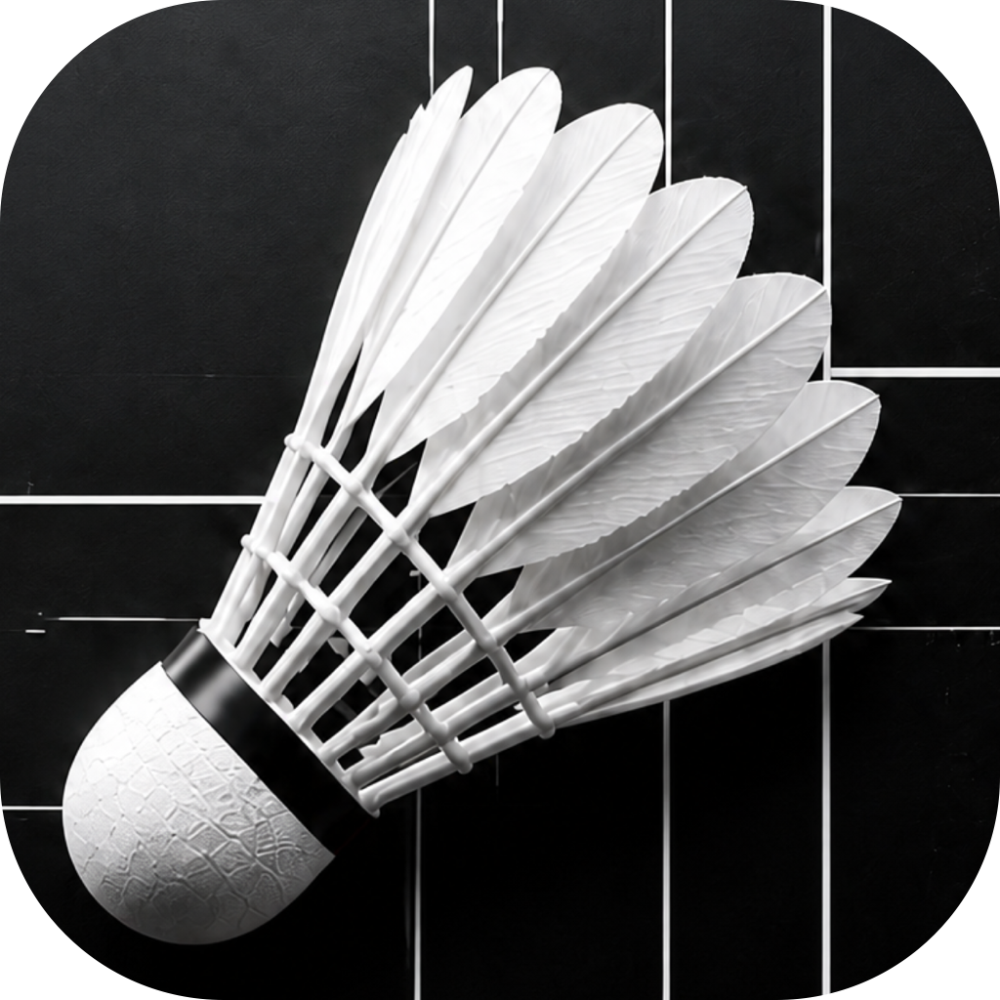

<div align="center">



# Smash

Free, open-source badminton tracking for iPhone and iPad.

[](#)
[](#)
[](LICENSE)

</div>

## What it does

Smash keeps your badminton records on your device. Log court time (with the score in the same form), the drills you work on, and the tournaments you enter. There's no account and no sign-in. It works offline, and iCloud sync is there if you want the same data on more than one device.

## Features

- Sessions. One tab for everything you log. Tap the plus button, pick Singles, Doubles or Training, and the form opens straight away. The list below keeps play sessions, scored matches and training together in date order.

- Players. Keep a list of the people you play with. Pick one when you log a session or match and the name and level carry over. Partners come from the same list.

- Court time and scoring. Log a date, start time and duration on court. Scoring lives inside the same form: choose 15-point or 21-point rally rules, continuous games or best-of-three, then add games, intensity, your opponent's level and a partner for doubles. Smash works out your win rate and how you do with each partner.

- Training. Add as many drills as you worked on, each with its own sets and difficulty, plus focus areas and notes on what to repeat next time. Pick a drill from the inline menu or type your own — there's no separate library to browse.

- Tournaments. Round robin, knockout, league or ladder. Link matches to an event, track your placement and keep notes on what worked.

- Dashboard. Sessions this week, matches, win rate and loss rate in four cards, followed by form rating, goal progress and an activity chart. The chart counts sessions — its caption reads "in number of sessions". Light and dark are a tap away at the top.

- Form rating. An Elo-style score built from your last 30 days. Everyone starts at 1400; wins lift it, losses pull it down, and beating a stronger player moves it more. It appears on the Dashboard and Profile.

- Coach's Corner. Short, explainable reads from your recent matches — form, opponents, partnerships and game patterns — each with the evidence behind it and one practical next step. It never claims causation.

- Personalization. Appearance and 12- or 24-hour time. Goal cadence lives in Profile. A short tour runs once after setup and you can replay it whenever you like.

- Backup and import. Export everything as JSON, encrypted with a password if you want. Importing adds records back without replacing anything already there, then restores your profile settings from the backup.

- Profile. Your avatar (a black badge with an icon you can tint), name and skill level, plus Settings, the policies, Support Smash and the version number.

- Goals. Set a weekly or monthly target, like five sessions a week. The Dashboard counts play and training sessions toward it and lets you know when you hit it.

No accounts, no analytics, no tracking. Your records are local by default; switch on iCloud in Settings if you want them on more than one device. Your profile (name, skill, avatar and goal) can also follow you through iCloud key-value storage when you're signed in.

## Policies

- [Privacy Policy](Docs/PRIVACY.md)
- [Terms of Use](Docs/TERMS.md)
- [Usage Guide](Docs/USAGE.md)

These are linked from Profile in the app and used for the App Store policy fields.

## Design

Smash follows Apple's Human Interface Guidelines. Motion is spring-based and interruptible, presses give instant feedback, materials sit over hard borders, and type scales with Dynamic Type. Haptics fire on the same frame as the visual change.

## Building

You need Xcode 16+ and [XcodeGen](https://github.com/yonaskolb/XcodeGen) (`brew install xcodegen`).

```bash
git clone https://github.com/ciscosub9/Smash.git
cd Smash
xcodegen generate   # creates Smash.xcodeproj from project.yml
open Smash.xcodeproj
```

Pick the **Smash** scheme and run it on an iPhone simulator with ⌘R. Tests run with ⌘U.

### iCloud sync

Sync uses CloudKit and needs the iCloud capability with your own development team.

1. Open the generated project, then **Smash target → Signing & Capabilities**.
2. Add your team. The container `iCloud.com.smashapp.smash` is already declared.
3. In the app, go to **Settings → Storage → iCloud**.

If the capability isn't there, the app just stays on local storage.

## Architecture

```
Smash/
├── Models/       SwiftData models: PlaySession, TrainingSession, Match, Tournament, Player
├── Services/     SmashStore (container + sync), Backup, Stats (pure aggregation logic)
├── Views/        Dashboard, Sessions, Players, Tournaments, Profile, Settings
├── Design/       Shared components: press styles, stat cards, empty states
└── Tests/        Swift Testing suites for scoring, stats, backup and coach-insights logic
```

It's Swift 6 with main-actor-by-default isolation. SwiftData handles storage. Scoring and stats are pure functions with unit tests, so they don't depend on the database. No third-party dependencies.

## Contributing

Issues and pull requests are welcome. If you're planning a big change, open an issue first so we can talk it through. All contributions land under GPL-3.0.

## License

Smash is [free software](https://www.gnu.org/philosophy/free-sw.en.html) under the [GNU General Public License v3.0](LICENSE).

You can use it, study it, change it and share it. If you fork it or build on it, including in a commercial or App Store release, you have to release your source under GPL-3.0 too. Closed-source copies aren't allowed. A credit and a link back here are welcome but not required.

One wrinkle: the GPL is widely seen as incompatible with App Store distribution, since Apple's DRM and review rules don't fit the GPL's terms. As the copyright holder, I can still put my own builds on the App Store; the license doesn't bind me. If someone else wants to do that, they need to follow the GPL.
